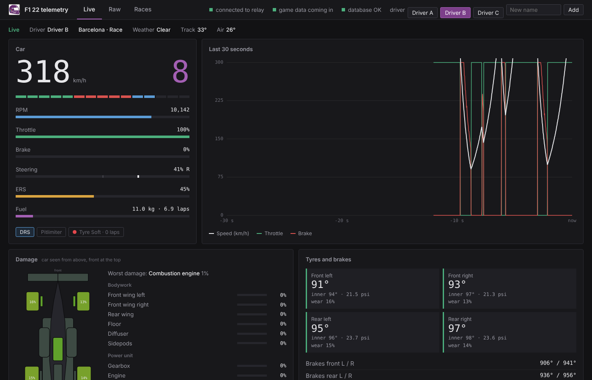
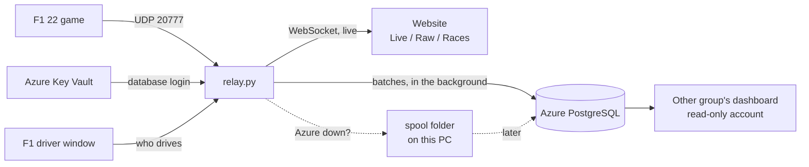
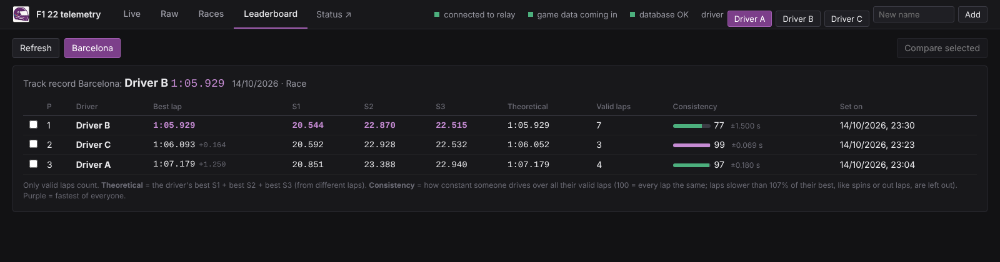
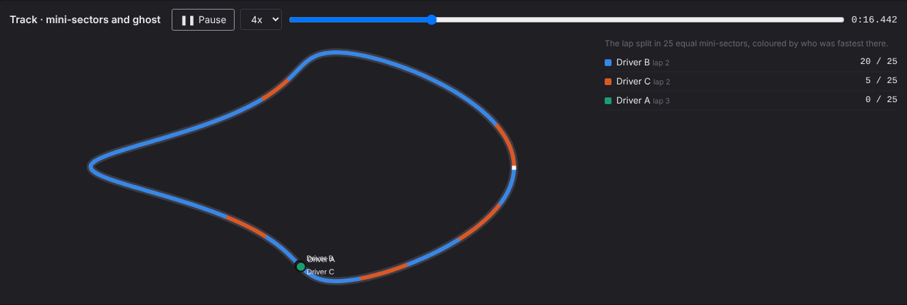
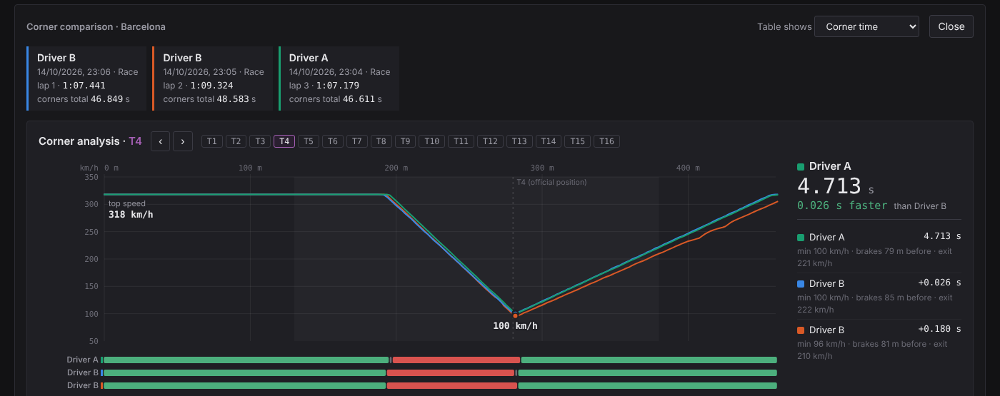

# F1 22 Telemetry Relay

Live telemetry from the **F1 22** game on a web dashboard, with every packet stored in an
**Azure PostgreSQL** database, so drivers can be compared lap by lap and corner by corner afterwards.

Built for a Fontys school project: four drivers take turns on one simulator PC, and another group builds
their own dashboard on the stored data.

## Features
- **Live dashboard** - speed, gear, RPM, throttle/brake/steering, ERS, fuel, tyres, brakes, a 30 s chart,
  a damage map of the car, track map, G-force circle, standings and race events, updated in real time
- **Live delta** - green/red time difference with the group's fastest lap on this track, while you drive
- **Leaderboard** - per track the best lap of every driver, best sectors, theoretical best and a consistency score
- **Personal bests and track records** - a pop-up and an event the moment someone beats their own or the group's best
- **Raw view** - every incoming packet with counters, to prove the data flows
- **Races** - every stored run with lap and sector times, consistency, a tyre wear chart with pit advice,
  replay in the Live view, download as a zip, a printable session report (PDF)
- **Corner comparison** - drivers compared on every official F1 corner: corner time, entry/minimum/exit
  speed, braking point, throttle point and overlaid speed lines, plus a track map coloured by mini-sector winner
  and a ghost of every driver's lap driving over it
- **Status page** - `/status` shows whether the relay runs, data comes in and Azure is reachable; the same is
  written to the table `f1_status` for the other group
- **One run per driver** - switch drivers on the website, in a small always-on-top window or in the console;
  every driver gets their own run, even in the same game session
- **Nothing gets lost** - data that is not in Azure yet waits on the PC and is sent later, also after a restart
- **No passwords in the code** - the database login lives in Azure Key Vault
- **Low cost** - the database turns itself on when someone races and off when nobody does; the PC's IP is
  kept in the database firewall automatically

## How it works

The live view never waits for the database: packets go to the browser right away and to Azure in batches.

## Quick start
1. Install Python 3 and the Azure CLI, run `az login` (details below).
2. Double-click **`start.bat`**. The first time it sets everything up, including the Key Vault login.
3. In F1 22 set UDP telemetry to IP `127.0.0.1`, port `20777`, format `2022`.
4. Drive. The dashboard opens at http://127.0.0.1:8000.

No game at hand? Double-click **`demo.bat`**: a fake game drives laps and everything works, but nothing is stored.

| Leaderboard | Mini-sectors and ghost |
|---|---|
|  |  |

| Corner analysis | Driver window |
|---|---|
|  |  |

## Installing on a new PC (once)
1. Copy this folder to the PC (or `git clone https://github.com/PepijnIriks/f1-telemetry-relay.git`).
   Do **not** copy `.venv` (it is made again) or `exports` (big CSV files).
2. Install Python 3 from https://www.python.org/downloads/ and tick **"Add python.exe to PATH"**.
3. Install the Azure CLI. In PowerShell: `winget install -e --id Microsoft.AzureCLI`.
   Close PowerShell, open a new one and run `az login` (log in with your Fontys account).
4. Double-click `start.bat`. The first time it installs the Python packages and, because no key vault
   can be read yet, it starts the **Key Vault setup** (see "Database login: Azure Key Vault").
5. In F1 22: Settings > Telemetry Settings: UDP Telemetry **On**, UDP Broadcast Mode **Off**,
   UDP IP Address **127.0.0.1**, UDP Port **20777**, UDP Send Rate **20Hz** or higher, UDP Format **2022**.
6. Put the names of your group in `DRIVERS=` in `config/config.env`.

## Starting
- Windows: double-click `start.bat`
- **Demo without the game: double-click `demo.bat`** (fake data, nothing is written to the database)
- Fake data that *is* stored (testing): `start.bat simulate`
- What is already in the database: double-click `inspect-db.bat`
- Set up / change the database login in Key Vault: double-click `setup-keyvault.bat`

On start you get a short start-lights animation (turn it off with `SHOW_INTRO=0` in `config/config.env`).
The website opens automatically at http://127.0.0.1:8000 (tabs: `#live`, `#raw`, `#races`).

## Folders
| Folder / file | What |
|---|---|
| `start.bat` | Start everything in one go |
| `demo.bat` | Demo with a fake game; nothing is stored |
| `inspect-db.bat` | Shows all tables and row counts in the Azure database |
| `setup-keyvault.bat` | Once: puts the database login in Azure Key Vault |
| `export_csv.py` | Exports all database tables to CSV (`python export_csv.py`) |
| `config/config.env` | Settings: ports, name of the key vault, Azure on/off, driver names and buttons. **No passwords** |
| `src/relay.py` | The relay: UDP in, parsing, website, database writer |
| `src/f1_format.py` | F1 22 packet formats and names (tracks, session types...) |
| `src/corners.py` | Official F1 corners: corner times, speeds, braking points, lap traces |
| `src/schema.py` | The database tables |
| `src/spool.py` | Keeps data that is not in Azure yet on this PC (folder `spool`), so nothing is ever lost |
| `src/create_readonly.py` | Used by `create-readonly-user.bat` |
| `src/insights.py` | Leaderboard, consistency, tyres and pit advice, track outline, status row |
| `web/status.html`, `web/report.html` | Status page and printable session report |
| `create-readonly-user.bat` | Makes a read-only database account for the other group |
| `src/azure_power.py` | Turns the Azure database on and off and keeps the firewall up to date |
| `src/intro.py` | The startup animation |
| `src/secrets_store.py` | Reads the database login from Azure Key Vault |
| `src/azure_firewall.py` | Keeps this computer's IP in the Azure firewall |
| `install-firewall-task.bat` | Once per computer: checks the firewall every 15 minutes in the background |
| `src/setup_keyvault.py` | Used by `setup-keyvault.bat` |
| `src/drivers.py` | The list of driver names |
| `src/driver_menu.py` | The small "F1 driver" window |
| `src/simulate.py` | Fake game for testing and demos |
| `src/inspect_db.py` | Used by `inspect-db.bat` |
| `web/index.html` | The website (Live / Raw / Races) |
| `requirements.txt` | Python packages (installed automatically) |

## Choosing the driver
Three ways, all doing the same thing (the current run is closed and a new run starts for the new driver):

| Where | How |
|---|---|
| **Website** | Click a name at the top right. Type a new name in "New name" and press Enter to add someone. Hover a name and click × to remove it from the list |
| **"F1 driver" window** | Opens by itself next to the relay. Click a name (or press 1-9). Type a new name + Enter to add, right-click a name to remove it. "Always on top" keeps it above the game (game in windowed / borderless mode) |
| **Black relay window** | Type the number of a name (or a new name) and press Enter. Enter on an empty line shows the list |

The names come from `DRIVERS=` in `config/config.env`; names added later are remembered in `config/drivers.json`.
When `start.bat` starts you can also pick the first driver by number. Turn the window off with `DRIVER_MENU=0`.

## What happens when you change drivers
When you pick another name (website, window or black window), the relay:
- closes the run of the previous driver (it stays in the database with that driver's name),
- starts a new run for the new driver with the next game data, even if the game session just continues
  (you don't have to restart the session).

The lap that is in progress at the moment of the switch is driven by two people, so it is marked invalid and
never counts in comparisons. Tip: switch in the garage or at the start of an out lap.
If the current run has no name yet, setting a name just gives that run the name (no new run).
In the black window you see lines starting with `[DRIVER]` for every switch.

## Comparing drivers per corner
In the **Races** tab, tick two or more runs on the same track and click **Compare corners**.
Choose **Fastest lap** (each driver's fastest valid lap) or **Best per corner** (each driver's best time in
every corner over all their valid laps). You get:
- **Corner analysis** per corner (pick it with the T1, T2... buttons, the arrows, or by clicking a corner in the
  chart or table): the speed line of every driver through the corner on top of each other, the top speed and the
  lowest speed, a bar per driver showing where they were braking / rolling / on full throttle, and on the right who
  was fastest and by how much. Hover over the chart to see every driver's speed at that point and how much time
  they have lost there so far.
- a chart with the time each driver loses per corner to the fastest driver in that corner,
- a table per corner with corner time, minimum (apex) speed, entry speed, exit speed, braking point and
  full-throttle point (pick with "Table shows"), plus "corners won" and the total of all corners.

How it works:
- `config/corners.json` holds the **official F1 corner numbers** and their distance from the start/finish line
  for every F1 22 track (from the official F1 live-timing data via FastF1; 2022 layouts, Hockenheim and Shanghai
  from 2019, Portimao and Sochi from 2021). Hanoi and the short layouts have no list.
- The distances are scaled to the lap length the game reports, so they line up with the game's lap distance.
- A corner zone runs from about 150 m before to 100 m after the corner (never overlapping the next corner).
- The relay works the corners out live after every lap and stores them in the tables `f1_corners` and `f1_lap_traces`.
  For runs that were stored before this existed, it works them out from the raw data the first time you compare them.
- If a corner looks shifted on a track, add `"offset": <metres>` to that track in `config/corners.json`.

## In the game
UDP Telemetry on, format 2022, IP 127.0.0.1 (the relay runs on the game PC itself), port 20777.
Allow Python in the Windows firewall if asked.

## Database login: Azure Key Vault
No username or password is stored in the code or in `config/config.env`. The full connection string
(server, username, password) is a secret in **Azure Key Vault**; the relay reads it at startup with your
`az login`. `config/config.env` only contains the name of the vault (`KEYVAULT_NAME`) and of the secret
(`KEYVAULT_SECRET`, default `f1-database-url`).

The vault is **F1Vault** (resource group F1, Poland Central). Set it up once with `setup-keyvault.bat`
(start.bat starts it by itself when the login can't be read yet). It:
1. uses the vault in `KEYVAULT_NAME` (or creates one if it does not exist),
2. gives your own account access to the secrets,
3. looks up the server name and admin username in Azure (you don't type them),
4. asks for the database password (hidden) **or** makes a new strong password and sets it on the server,
5. stores the connection string in the vault and writes `KEYVAULT_NAME` in `config/config.env`.

At the top of the website it says "database OK" when it works; otherwise it shows what is wrong (also in the
black window, lines starting with `[SECRETS]` and `[DB]`). Other people who run the relay or `export_csv.py`
need the role **Key Vault Secrets User** on the vault (portal > key vault > Access control (IAM)).
For a quick local test you can pass a connection string in the environment variable `DATABASE_URL` instead.

## Database on/off and firewall (automatic)
The relay manages the Azure database itself, so it doesn't use credit all day:
- **On** when the relay starts (takes 2 to 5 minutes; data that already comes in is kept and written afterwards).
- **Off** after `AZURE_STOP_AFTER_MIN` minutes (default 15) without racing and without anyone using the Races tab.
  It only turns back on when someone really races again (car driving on track), or when you click
  **Start database** in the Races tab. Game menus, a paused game or opening the website do not turn it on.
- **Off** when you close the relay (close the window or Ctrl+C).
- **Firewall:** the current public IP of this PC is put in the Azure firewall automatically (one rule called
  `relay-<computer name>`, updated when your IP changes). Turn it off with `AZURE_AUTO_FIREWALL=0`.

### Always access from this computer (no manual firewall rules)
Every computer that uses the database gets its own firewall rule `relay-<computer name>`, which is updated
automatically when its public IP changes (other wifi, school, home). This happens:
- when you start `start.bat`, `inspect-db.bat` or `export_csv.py`,
- and every 15 minutes in the background after you double-click **`install-firewall-task.bat`** once on that
  computer (a Windows scheduled task; remove it with `remove-firewall-task.bat`). Handy when you use pgAdmin or
  DBeaver without the relay. What it did is written to `firewall.log`.

Azure does not allow firewall changes while the database is stopped; the relay sets the rule right after it
has started the database. Check it by hand (PowerShell, in this folder): `.venv\Scripts\python.exe src\azure_firewall.py`

Needed once on the PC (PowerShell): `winget install -e --id Microsoft.AzureCLI`, then a new window and `az login`.
Messages about this appear in the black window (lines starting with `[AZURE]`). Turn the on/off feature off with `AZURE_AUTO_POWER=0`.

Note: while the database is off, the other group (dashboard) can't reach it either.

## What is stored
The tables are created right after connecting (even without data) and start with `f1_`,
so they never clash with other tables in the same database:
- `f1_telemetry_raw`: every packet with timestamp, driver, session, run, type, frame, session time and the raw bytes
- `f1_sessions`: one row per **run** (`run_id`; one driver each) with the game session, driver, track, track length, session type, start, end
- `f1_laps`: lap time and sector times per lap per run, with a flag for invalid laps
- `f1_corners`: per run, lap and official corner: corner time, entry/minimum/exit speed, braking point and full-throttle point
- `f1_lap_traces`: per run and lap: speed, throttle, brake and lap time every 2 metres of the lap (arrays), used for the speed lines

Runs stored before the driver-switch feature keep `run_id` = their `session_uid`; the relay adds the new
columns itself on start (nothing to do by hand).

## Nothing gets lost
Everything that is not in Azure yet (database off or still starting, no internet, relay closed) is written
to the folder `spool` on this PC. As soon as the database can be reached again, the relay sends those files to
Azure (oldest first, new data waits until they are in) and only removes a file after Azure confirmed it.
This also works after a restart, a closed window or a PC shutdown. In the black window you see
`[DB] Sent ... saved packets from this PC to Azure`. Don't delete the `spool` folder while it has files.

## Website only on this PC
By default the website and the telemetry port only accept connections from this PC (`WEB_HOST=127.0.0.1`,
`UDP_HOST=127.0.0.1`), so nobody else on the (school) wifi can see the data or change the driver.
Want to watch on a phone or tablet? Set `WEB_HOST=0.0.0.0` in `config/config.env` and open
`http://<IP of this PC>:8000` there (anyone on that network can then use it).

## In the Races tab
- **Download**: everything of one run as a zip: laps, corners, speed lines and every raw packet (CSV), for a
  backup outside Azure or to analyse in Excel/Python. A README in the zip explains the files.
- **Change driver**: forgot to switch? Give the run the right name afterwards. Only the name changes.

## Leaderboard, delta and records
- **Leaderboard tab**: pick a track; per driver the fastest valid lap, best S1/S2/S3 (purple = fastest of all),
  theoretical best (best sectors added up) and consistency. Tick drivers and click **Compare selected** to open
  the corner comparison of their fastest laps.
- **Live delta** (Lap card): during a lap the time difference with the group's fastest lap on this track at the
  same point of the lap. Green = faster. It needs one stored valid lap on that track.
- **Records**: when a valid lap beats the driver's own best on that track, or the best of everyone, a pop-up
  appears and an event is added (`[RECORD]` in the black window).

## Analysis per run
In the Races tab, click a run:
- **Consistency**: 0-100, how close the valid laps are to each other (laps slower than 107% of the best,
  like spins or out laps, are left out; 1% spread = 90).
- **Tyres and strategy**: wear of each tyre per lap, tyre changes and temperatures, and a simple pit advice
  (pit window when the worst tyre passes 60% wear or lap times drop more than 1.5% for two laps).
- **Report (PDF)**: a clean printable page with winner, results, lap times and the corner-by-corner table;
  click "Save as PDF". In the corner comparison the same button makes a report of all selected runs.

## Mini-sectors and ghost
In the corner comparison, the track map splits the lap into 25 equal mini-sectors and colours each one by the
driver who was fastest there. **Play ghost** lets every driver's lap drive over the map at the same time
(1x to 8x, or drag the slider). The track outline is worked out once per track from the raw data and kept in
`config/trackmaps.json`.

## Status page
Open http://127.0.0.1:8000/status (or "Status" at the top): relay running, game data coming in, who drives,
database connected, packets stored today and anything still waiting on this PC. Every minute the relay also
writes this to the table `f1_status` (one row, `info` as JSON), so the other group can check from their side
whether data is coming in: if `updated_at` is more than a few minutes old, the relay is not running or the
database is off.

## Read-only account for the other group
Double-click `create-readonly-user.bat` (with the database on). It makes the account `f1_reader` that can read
every table, also tables made later, but can never change or delete anything, and stores its login in Key Vault
(secret `f1-readonly-url`). The window shows how to get it to the other group. Running it again gives a new
password (the old one stops working). They also need their own IP in the database firewall.

## Keeping costs down
The Azure server is a Burstable B1ms with 64 GB storage and **storage autogrow off**, so the storage bill is
fixed and can't grow by itself. The things that matter:
- **Database off when nobody races** (see "Database on/off"): compute is billed per hour only while it is on.
- **Nothing is ever thrown away:** every packet is stored, so all data can be found later.
- **Warning before it is full:** a full database becomes read-only. When the database passes `DB_WARN_GB`
  (default 50 of the 64 GB), the black window and the website show a warning, so you can make the storage
  bigger in the Azure portal in time (f1db > Compute + storage; storage can only grow, never shrink).
- The size is printed every 10 minutes in the black window (`[DB] Storage: ...`) and shown on the Raw tab.

## Old races
The relay reads (read only) the tables `f22_car_telemetry`, `f22_lap_data`, `f22_motion`, `f22_session` and `f22_session_history` of the earlier collector, if they are in the same database. If that fails, a message appears at the top of the Races tab; run `inspect-db.bat` to see what is in the database.

## Notes
- The track map draws itself during the first lap and is remembered per track in the browser.
- Standings and events are only available live, not in a replay.

## GitHub
The code is on https://github.com/PepijnIriks/f1-telemetry-relay. `.venv`, `exports` and caches are never
committed (`.gitignore`), and there are no passwords in any file, so the repo is safe to share with the group.
