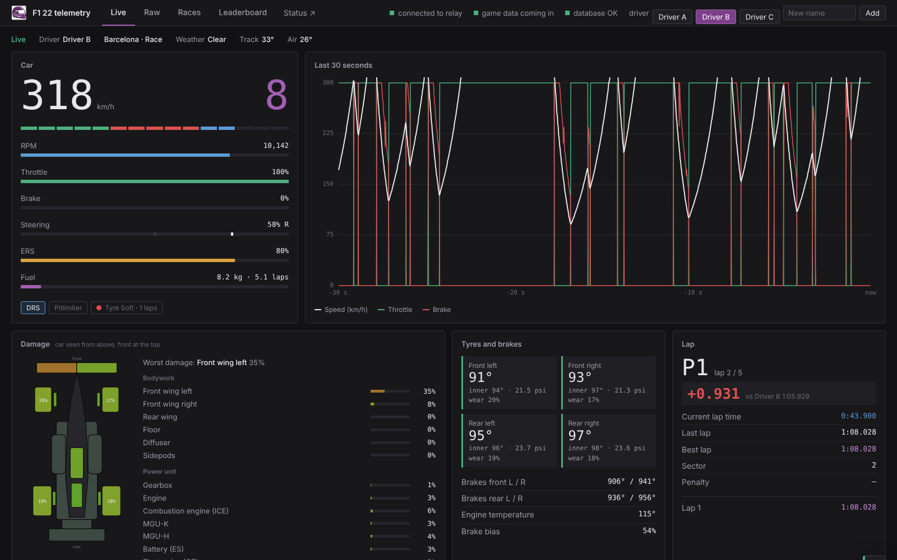
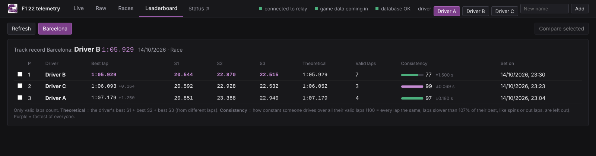
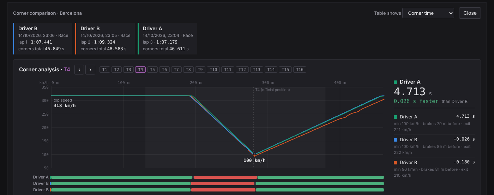
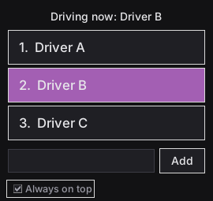
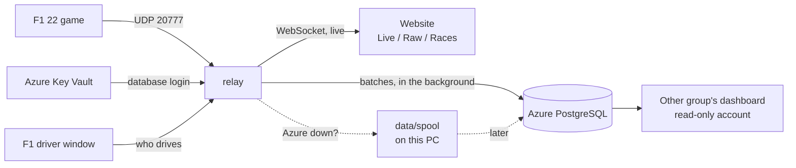

# F1 22 Telemetry Relay

Live telemetry from the **F1 22** game on a web dashboard, with every packet stored in an
**Azure PostgreSQL** database, so drivers can be compared lap by lap and corner by corner afterwards.

Built for a Fontys school project: four drivers take turns on one simulator PC, and another group builds
their own dashboard on the stored data.

## Features
- **Live dashboard** - speed, gear, RPM, pedals, ERS, fuel, tyres, brakes, damage, track map, G-force,
  standings and race events, in real time; plus a **live delta** to the group's fastest lap
- **Races, leaderboard and corner comparison** - every stored run with lap and sector times, replay, tyre
  wear and pit advice, a printable report; drivers compared on every official F1 corner, with a ghost lap
- **One run per driver** - switch drivers on the website or in a small always-on-top window
- **Nothing gets lost** - data that can't reach Azure waits on the PC and is sent later
- **Low cost** - the database turns itself on when someone races and off when nobody does, stores the raw
  packets compressed, and keeps this PC in its firewall automatically
- **No passwords in the code** - the database login lives in Azure Key Vault

| Leaderboard | Mini-sectors and ghost |
|---|---|
|  |  |

| Corner analysis | Driver window |
|---|---|
|  |  |

## How it works

The live view never waits for the database: packets go to the browser right away and to Azure in batches.

## Put it on a computer (the game PC, or any other)
1. On GitHub: **Code > Download ZIP**, and unzip it where you like (for example on the desktop).
   Or, with Git: `git clone https://github.com/PepijnIriks/f1-telemetry-relay.git`
2. Double-click **`start.bat`**. The first time it:
   - offers to install **Python** and the **Azure CLI** when they are missing (then close the window and start it again),
   - makes the Python environment and installs the packages,
   - opens a browser once to log in to Azure (Fontys account) and reads the database login from Key Vault.
3. In F1 22: *Settings > Telemetry Settings*: UDP Telemetry **On**, Broadcast Mode **Off**, IP **127.0.0.1**,
   port **20777**, send rate **20 Hz** or higher, format **2022**. Allow Python in the Windows firewall if asked.

Nothing in the code has to be changed for another computer: the settings in `config/config.env` are the same
everywhere, and every computer adds itself to the database firewall. Only if the group changes: the names in
`DRIVERS=` in `config/config.env`.

## Every day
| | |
|---|---|
| **`start.bat`** | Start the relay: the website opens at http://127.0.0.1:8000, plus the small "F1 driver" window |
| **`demo.bat`** | Demo without the game: a fake game drives laps, nothing is stored |
| **`tools.bat`** | Everything else, in one menu: what is in the database, export to CSV, compress the database, Key Vault setup, read-only account for the dashboard group, firewall check, tests, GitHub sync |

## What is in this folder
| | |
|---|---|
| `start.bat`, `demo.bat`, `tools.bat` | The three things you double-click |
| `config/` | Settings (`config.env`, no passwords) and the official F1 corner list |
| `src/` | The relay (Python): start file `relay.py`, one module per job |
| `web/` | The website |
| `docs/` | [Guide](docs/GUIDE.md) with all details, [database guide for the dashboard group](docs/DATA.md), [changelog](docs/CHANGELOG.md), screenshots |
| `tests/` | Automated tests (`tools.bat` > 10; GitHub runs them for every change) |
| `data/` | Made by this computer itself: data waiting for Azure, exports, caches, logs. Not on GitHub |
| `.venv/` | The Python environment, made by `start.bat`. Not on GitHub; never copy it to another computer |

## GitHub and versions
Every change gets its own commit with an explanation of what changed and why: see **Commits** on GitHub
(click one to see the changed lines). Bigger changes come as a **pull request** with a summary;
[docs/CHANGELOG.md](docs/CHANGELOG.md) says per version what changed. `tools.bat` > 11 gets the newest
version onto this computer, and puts changes made on this computer on GitHub (with a short description).
The branch `v1.0-start` keeps the version from before v1.1.
