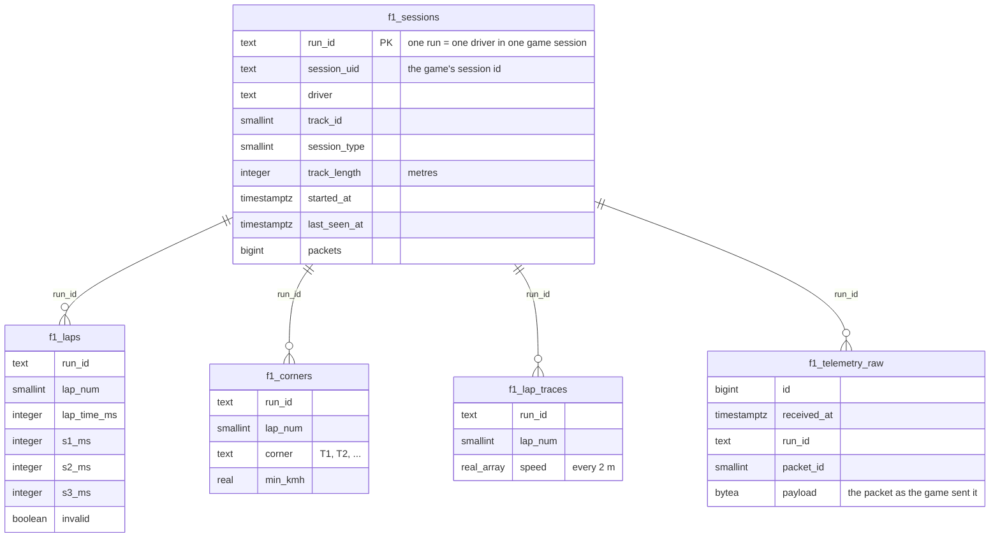

# F1 telemetry database - guide for the dashboard group

This describes everything the relay stores, so you can build a dashboard on it without having to ask.
All tables are in the `public` schema of the Azure PostgreSQL database and start with `f1_`.

## Getting access

| What | How |
|---|---|
| Account | `f1_reader`, **read only** (can never change or delete anything). Ask Pepijn to run `tools.bat` > 7; the login is in Azure Key Vault **F1Vault**, secret `f1-readonly-url` |
| Firewall | Your public IP must be allowed on the server: send it to Pepijn, or get the role to add a rule yourself (Azure portal > the server > Networking) |
| Database on? | To save money the server is **off when nobody races** (it turns on when someone races). Check `f1_status` (below) or ask before you start working |
| Connection | `sslmode=require`, port 5432, database `postgres` |

## The tables in one picture



**Start with `f1_sessions`, `f1_laps` and `f1_corners`**: they are small, already worked out and fast.
Only use `f1_telemetry_raw` when you need something that is not in those tables (for example the gear or
tyre temperatures at every moment).

## f1_sessions - one row per run

A *run* is one driver in one game session. When the drivers switch during a session, a new run starts
(same `session_uid`, new `run_id`). The driver's name is only correct here: if a name was wrong it is
fixed in this table only.

| Column | Meaning |
|---|---|
| `run_id` | Unique id of the run. Join everything on this |
| `session_uid` | The game's id of the session (several runs can share it) |
| `driver` | Who drove (always use this column for the driver's name) |
| `track_id` | Track number, see the list below |
| `session_type` | 1-4 practice, 5-9 qualifying, 10-12 race, 13 time trial |
| `track_length` | Lap length in metres, as the game reports it |
| `started_at`, `last_seen_at` | First and last packet of the run (UTC) |
| `packets` | Number of packets received in this run |

## f1_laps - one row per completed lap

| Column | Meaning |
|---|---|
| `run_id`, `lap_num` | Which run and lap (unique together) |
| `lap_time_ms` | Lap time in milliseconds (`83456` = 1:23.456) |
| `s1_ms`, `s2_ms`, `s3_ms` | Sector times in milliseconds |
| `invalid` | `true` = the lap does not count (track limits, or the lap during which the driver changed) |

## f1_corners - per lap, per official F1 corner

| Column | Meaning |
|---|---|
| `run_id`, `lap_num`, `corner` | Run, lap and corner name (`T1`, `T2`, ... official F1 numbering) |
| `corner_idx` | Order of the corner on the lap (0 = first) |
| `apex_m` | Distance of the corner from the start/finish line, metres |
| `time_ms` | Time spent in the corner zone (about 150 m before to 100 m after the apex) |
| `entry_kmh`, `min_kmh`, `exit_kmh` | Speed into the zone, lowest speed, speed out of the zone |
| `min_at_m` | Where the lowest speed was, relative to the apex (negative = before) |
| `brake_before_m` | How many metres before the apex the driver started braking |
| `throttle_after_m` | How many metres after the apex the driver was back on full throttle |
| `max_brake` | Hardest braking in the corner (0-1) |

## f1_lap_traces - per lap, a value every 2 metres

`speed` (km/h), `throttle` and `brake` (0-1) and `time_ms` (lap time so far) are arrays with one value per
`step_m` (2) metres of the lap: element 0 = start line, element 100 = 200 m into the lap. Handy for speed
graphs that compare drivers.

## f1_status - is the relay running?

One row (`name = 'relay'`), updated every minute while the relay runs. `info` (JSON) holds: game data
coming in, current driver, track, packets today, database size.
If `updated_at` is more than a few minutes old, the relay is not running (and the database may be off).

```sql
SELECT updated_at, info->>'driver' AS driver, info->>'track' AS track FROM f1_status;
```

## f1_telemetry_raw - every packet of the game

| Column | Meaning |
|---|---|
| `id` | Increasing number (order of arrival) |
| `received_at` | When the packet arrived (UTC) |
| `run_id` | The run (join with `f1_sessions`) |
| `packet_id` | Packet type: 0 Motion, 1 Session, 2 LapData, 3 Event, 4 Participants, 5 CarSetups, 6 CarTelemetry, 7 CarStatus, 8 FinalClassification, 9 LobbyInfo, 10 CarDamage, 11 SessionHistory |
| `frame`, `session_time` | The game's frame number and session clock (seconds) |
| `player_idx` | Which of the 22 cars is the player's car |
| `payload` | The whole packet as bytes, exactly as the game sent it (format: the official *F1 22 UDP specification* from EA) |
| `driver` | Name at the moment of recording. **Use `f1_sessions.driver` instead** (that one is corrected) |
| `session_uid` | The game's session id |

The table is stored **compressed** per week (TimescaleDB). You do not notice that: query it with normal SQL.
Always filter on `run_id` (and `packet_id`): that is fast. Queries without such a filter read the whole history.

### Reading values out of `payload`

Every packet starts with a 24-byte header. After it come the data of the 22 cars, one block per car;
the player's car is block `player_idx`. All numbers are little endian.

| Packet | Block size | Offsets in the block (bytes) |
|---|---|---|
| 6 CarTelemetry | 60 | 0 speed km/h (uint16), 2 throttle (float), 6 steer (float), 10 brake (float), 15 gear (int8), 16 engine RPM (uint16), 18 DRS (uint8) |
| 2 LapData | 43 | 0 last lap ms (uint32), 4 current lap ms (uint32), 12 lap distance m (float), 24 position (uint8), 25 lap number (uint8), 26 pit status (uint8) |
| 0 Motion | 60 | 0 x, 4 y, 8 z world position (floats) |

Speed of the player's car in SQL (uint16 = low byte + 256 x high byte):

```sql
SELECT r.session_time,
       get_byte(r.payload, 24 + r.player_idx * 60) + 256 * get_byte(r.payload, 25 + r.player_idx * 60) AS speed_kmh
FROM f1_telemetry_raw r
WHERE r.run_id = '...' AND r.packet_id = 6
ORDER BY r.id;
```

The same in Python (floats are easier there):

```python
import struct
TEL = struct.Struct("<HfffBbHBBH4H4B4BH4f4B")       # 60 bytes per car
speed, throttle, steer, brake, clutch, gear, rpm, drs, *rest = TEL.unpack_from(payload, 24 + player_idx * 60)
```

## Useful queries

Fastest valid lap per driver per track:

```sql
SELECT s.track_id, s.driver, min(l.lap_time_ms) AS best_ms
FROM f1_laps l JOIN f1_sessions s ON s.run_id = l.run_id
WHERE NOT l.invalid AND l.lap_time_ms > 0
GROUP BY 1, 2 ORDER BY 1, 3;
```

All laps of the newest run:

```sql
SELECT l.* FROM f1_laps l
WHERE l.run_id = (SELECT run_id FROM f1_sessions ORDER BY started_at DESC LIMIT 1)
ORDER BY l.lap_num;
```

Who brakes latest into each corner on Barcelona (track 4):

```sql
SELECT c.corner, s.driver, min(c.brake_before_m) AS latest_braking_m
FROM f1_corners c
JOIN f1_sessions s ON s.run_id = c.run_id
JOIN f1_laps l ON l.run_id = c.run_id AND l.lap_num = c.lap_num
WHERE s.track_id = 4 AND NOT l.invalid
GROUP BY 1, 2 ORDER BY min(c.corner_idx), 3;
```

## Track numbers

0 Melbourne, 1 Paul Ricard, 2 Shanghai, 3 Sakhir (Bahrain), 4 Barcelona, 5 Monaco, 6 Montreal, 7 Silverstone,
8 Hockenheim, 9 Hungaroring, 10 Spa, 11 Monza, 12 Singapore, 13 Suzuka, 14 Abu Dhabi, 15 Texas, 16 Brazil,
17 Austria, 18 Sochi, 19 Mexico, 20 Baku, 21 Sakhir Short, 22 Silverstone Short, 23 Texas Short,
24 Suzuka Short, 25 Hanoi, 26 Zandvoort, 27 Imola, 28 Portimao, 29 Jeddah, 30 Miami.

## Older data (f22_ tables)

Races from before this relay are in the tables of the earlier collector (`f22_car_telemetry`, `f22_lap_data`,
`f22_motion`, `f22_session`, `f22_session_history`), with one column per value instead of raw bytes.

## Other tables you may see

| Table | What |
|---|---|
| `f1_upgrade_progress` | Bookkeeping of a database upgrade; not interesting for a dashboard |
| `f1_telemetry_raw_old` | Only right after the compression upgrade: the old uncompressed copy, removed later |
