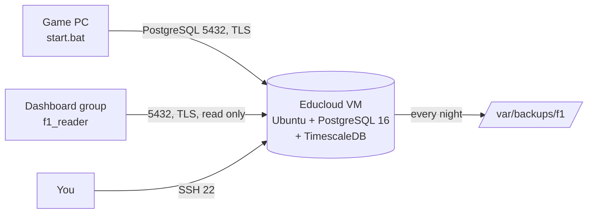

# Database server on Fontys Educloud

The relay stores everything in PostgreSQL on an Ubuntu VM in Fontys Educloud. This page sets that VM up
from nothing. It takes about 15 minutes, most of it waiting.



## 1. Make the VM (Educloud portal)
- **Template:** Ubuntu Server 24.04 (22.04 works too).
- **Size:** at least 2 vCPU, 4 GB RAM. **Disk:** 64 GB or more (all data is kept; compressed it grows slowly).
- **Network:** the VM needs an address the game PC can reach from the internet, with **port 5432** (PostgreSQL)
  and **port 22** (SSH) allowed to it. If Educloud has its own firewall / security group or port forwarding
  for the VM, open those two ports there.
- Write down the VM's **address** (IP address or DNS name) and the username you log in with.
- If Educloud turns VMs off after a while or has a lease time, set it so the VM stays on (or turn it on before
  racing). When the VM is off nothing is lost: the relay keeps the data on the game PC and sends it later.

## 2. Log in to the VM
On **your own PC** (PowerShell), with the address and username from step 1:
```
ssh <username>@<address of the VM>
```
Or use the console in the Educloud portal.

## 3. Run the setup script
On **the Educloud VM**:
```
wget https://raw.githubusercontent.com/PepijnIriks/f1-telemetry-relay/main/server/install-educloud.sh
sudo bash install-educloud.sh
```
It installs and sets up PostgreSQL 16 with TimescaleDB, the database `f1`, the login `f1_relay`, encrypted
connections, the firewall and the nightly backup. At the end it shows a block like this:
```
  postgresql://f1_relay:<long password>@<address>:5432/f1?sslmode=require
```
That line is the database login. Keep it secret: not in GitHub, a chat or an e-mail.

Running the script again is safe (nothing is removed, the password stays the same):

| On **the Educloud VM** | |
|---|---|
| `sudo bash install-educloud.sh --show` | Show the login line again |
| `sudo bash install-educloud.sh --new-password` | New password for `f1_relay` (then enter it again on every PC: `tools.bat` > 6) |
| `sudo bash install-educloud.sh` | Repair / update the setup |

If the address in the login line is wrong (the script shows a warning when the VM's own address differs from
its internet address), use the address you connect to in step 2 instead.

## 4. Link the game PC
On **the game PC**: double-click `start.bat`. The first time it asks for the database login: paste the line
from step 3 (right mouse click; you don't see it) and press Enter. It tests the connection and stores the login
in the Windows Credential Manager. Later, or on another PC: `tools.bat` > 6.

The relay window then says `[DB] Connected to <address> - tables ready, data is being stored`.

## 5. Give the dashboard group access
On **the game PC**: `tools.bat` > 7 makes the read-only account `f1_reader` and shows its login. Send it to
them privately. What they can find in the database is in [DATA.md](DATA.md).

## Every day: nothing to do
The VM is always on and the relay connects by itself. Useful commands, all on **the Educloud VM**:

| | |
|---|---|
| `sudo f1-backup` | Make a backup now (also happens every night at 04:15) |
| `sudo ls -lh /var/backups/f1` | List the backups (the last 14 days are kept) |
| `df -h /var/lib/postgresql` | Free disk space |
| `sudo systemctl status postgresql@16-main` | Is PostgreSQL running? |
| `sudo tail -n 50 /var/log/postgresql/postgresql-16-main.log` | Last lines of the database log (who connected, errors) |
| `sudo ufw status` | Firewall rules |
| `sudo apt update` then `sudo apt upgrade -y` | Updates (Ubuntu also installs security updates by itself) |

## A backup on another computer
The nightly backups are on the VM itself. To keep a copy somewhere else, on **your own PC** (PowerShell):
```
scp <username>@<address of the VM>:/var/backups/f1/<file name>.dump .
```
(First, on **the Educloud VM**, `sudo ls /var/backups/f1` shows the file names. If `scp` says "Permission denied",
run `sudo chmod 755 /var/backups/f1` and `sudo chmod 644 /var/backups/f1/*.dump` on the VM first.)
Or use `tools.bat` > 2 on the game PC for a CSV export of every table.

To put a backup back (on **the Educloud VM**; this adds the tables to the empty database `f1`):
```
sudo -u postgres pg_restore --dbname=f1 --no-owner --role=f1_relay /var/backups/f1/<file name>.dump
```

## Something does not work

| Message on the game PC | What to check |
|---|---|
| `Server unreachable (time-out)` | Is the VM on? Is port 5432 open in Educloud? On the VM: `sudo ufw status` must show `5432/tcp ALLOW` |
| `wrong password or username` | Login line copied completely? Show it on the VM (`--show`) and enter it again with `tools.bat` > 6 |
| `Server name not found` | The address in the login line: use the IP address instead of the name |
| `no pg_hba.conf entry` | Run `sudo bash install-educloud.sh` on the VM again |
| Data waits on the PC (`data\spool`) | Nothing is lost: it is sent as soon as the VM can be reached again |

## Security in short
- Only SSH (22) and PostgreSQL (5432) are open on the VM (ufw); fail2ban blocks SSH password guessing.
- PostgreSQL only accepts **encrypted** connections from outside, only for `f1_relay` and `f1_reader`, only to
  the database `f1`, only with a password (scram-sha-256). The superuser `postgres` only works on the VM itself.
- `f1_relay` can make and fill tables (and the read-only account), but cannot change server settings.
- No password is in the code or on GitHub: on the VM in `/root/f1-database-login.txt` (only root can read it),
  on each PC in the Windows Credential Manager.
